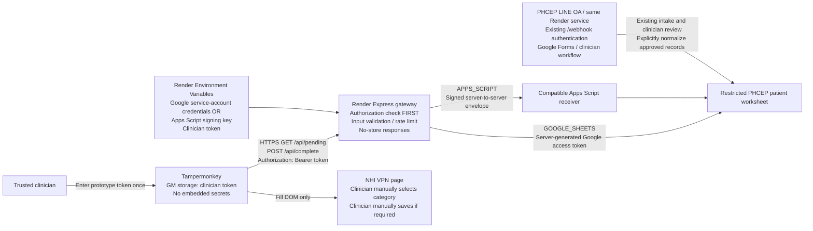

# PHCEP NHI patient gateway

This is a **single-clinician prototype**, not a deployed service. It implements a
patient Express API inside the existing PHCEP Render service. It preserves the
existing LINE webhook, Google Forms, and clinical frontend.

## A. Architecture



**Render is the client-facing authorization boundary.** Only Render accesses Google.
The browser token authorizes one trusted prototype clinician; it is not a Google
credential and must never be reused as an Apps Script signing key. Nothing
automatically authenticates Render through NHI VPN/hospital login.

The intake-to-patient-worksheet arrow is an **operator workflow**, not an implemented
automatic importer. Existing PHCEP `LINE對話`, `PHCEP表單紀錄`, and clinical scores
must not be treated as these patient columns without explicit clinical review and
normalization. Do not send national IDs, tokens, or patient clinical records via LINE.

## B. Render Express implementation and deployment

Files:

- [server.cjs](./server.cjs): existing HTTP gateway; dispatches `/api` to Express,
  preserves `/webhook` raw-body signature verification and `/healthz`.
- [patient-api.cjs](./patient-api.cjs): patient authorization and interchangeable adapters.
- [package.json](./package.json) / [package-lock.json](./package-lock.json): dependencies.
- [test/](./test/): synthetic HTTP, adapter, and userscript tests.
- [.env.example](./.env.example): placeholders only; not loaded automatically.

Use the **existing** `clinical-medicine` Render Web Service:

1. Repository: `dreamcheap2000/Clinical-Medicine`; Root Directory: `PHCEP/gateway/`.
2. Keep Build Command `npm install` (or use `npm ci --ignore-scripts` with the committed lockfile).
3. Keep Start Command `npm start`; runtime Node 22 or later.
4. Add patient runtime variables in **Render → Environment**, not code, Sheets, GitHub
   Actions secrets, build arguments, or credential files.
5. Configure health check `/healthz`. It proves liveness only, not Google access.
6. The userscript hostname is configured as `clinical-medicine.onrender.com`.
7. Verify unauthorized requests return 401, then test the entire authorized
   pending/fill/complete path with **synthetic records only**.

Keep the LINE webhook URL `https://clinical-medicine.onrender.com/webhook` and
all its existing environment variables unchanged. The patient routes use separate
bearer authorization; they do not accept LINE signatures as clinician credentials.
Existing LINE routes do not accept the patient token instead of a LINE signature.
Patient routes perform no LINE messages, clinical decisions, or NHI submission.

Enable with `PATIENT_API_ENABLED=true` only after patient configuration is complete.
When absent/false, `/api/*` returns 503 `PATIENT_API_DISABLED` and the LINE gateway
works as before. Invalid enabled patient configuration fails startup; validate
all variables before enabling so a typo does not interrupt the shared service.
Rollback by setting `PATIENT_API_ENABLED=false` and redeploying.

Run tests locally from this directory with `npm test`. Dependencies are installed
with `npm ci --ignore-scripts` after reviewing the dependency lockfile.

### Client API — stable across future authentication changes

Every patient route requires:

```http
Authorization: Bearer <CLINICIAN_TOKEN_ENTERED_AT_RUNTIME>
```

`GET /api/pending` (no query parameters):

```json
{
  "success": true,
  "patient": {
    "rowId": 123,
    "patientId": "TEST001",
    "name": "TEST PATIENT",
    "birthday": "1960-01-01"
  }
}
```

No pending records: `{ "success": true, "patient": null }`.
Only mapped form fields are returned; phone and unknown columns are excluded.

`POST /api/complete`, `Content-Type: application/json`:

```json
{ "rowId": 123 }
```

Confirmed completion: `{ "success": true }`.
Completion means **PHCEP workflow complete**, never “the NHI form was saved”.
Mark Complete is clinician-confirmed, not triggered automatically by Fill Form.
Unknown IDs return 404. Already-complete records succeed idempotently in Sheets mode.
No automatic backend retry, backend switching, or NHI submission is performed.

Errors have HTTP status 400/401/404/413/415/429/502/503 and shape:

```json
{ "success": false, "error": "SAFE_ERROR_CODE" }
```

The API does not return backend exception messages, Google response bodies,
credentials, or access tokens. Responses use `Cache-Control: no-store`.

### Direct Google Sheets mode — fully implemented adapter

Set `PATIENT_BACKEND=GOOGLE_SHEETS`. Enable Google Sheets API in the approved Google
project. Give the service account editor access **only to the intended spreadsheet**.
Do not make the spreadsheet public.

Required unique headers in the named worksheet:

| Header | Type / meaning |
|---|---|
| `rowId` | Unique positive integer, **immutable record ID**, not a physical sheet row number |
| `patientId` | Plain text; synthetic ID during testing |
| `name` | Plain text |
| `birthday` | Plain-text `YYYY/MM/DD` (or `YYYY-MM-DD`), not a Sheet date serial |
| `workflowStatus` | Exactly `DRAFT`, `PENDING` or `COMPLETE` |

`DRAFT` rows are never returned by `/api/pending`, and `/api/complete` refuses them
with `409 PATIENT_NOT_PENDING`. The clinician switches a row to `PENDING` only after
completing the HIS fields.

Optional columns match the approved userscript mapping:

```text
gender, visitDate, enrollmentDate, careStage, acuteAdmissionDate,
physicianId, physicianName, primaryDiagnosisCategory, primaryDiagnosisCode,
examDate, heightCm, weightKg, waistCm, labDate, hba1cPercent,
glycatedAlbuminPercent, fastingGlucoseMgDl, totalCholesterolMgDl,
triglyceridesMgDl, ldlCMgDl, hdlCMgDl, systolicMmHg, diastolicMmHg,
smoking, alcohol, betelNut
```

Nested fields use dotted columns, e.g.
`history.intracranialOrCarotidStenosis` (real Sheet Boolean checkbox, not `"TRUE"` text)
and `lifestyleScores.physicalActivity` (number). Supported nested keys are the
userscript's `HISTORY_KEYS` and `LIFESTYLE_KEYS`; unknown fields are not returned.
Dates and IDs must be stored as plain text to preserve formatting/leading zeroes.
Blank optional cells stay absent; they do not become zero/false.

The adapter reads the whole named worksheet, validates IDs/headers/statuses, selects
the **top-most** `PENDING` row in physical sheet order (not lowest `rowId`, not oldest
date), and updates **only** that record's `workflowStatus` cell. Other columns, such as
`hisDiagnosisCode`, `chartNo` and `importedAt`, are allowed but never returned.
There is no destructive row deletion or rewrite of clinical data.

### Importing HIS exports and follow-up time points

The importer is a separate **container-bound** script in the NHI spreadsheet itself
([`../nhi-sheet-script/`](../nhi-sheet-script/)), not part of the LINE Apps Script
project. It uses only the `spreadsheets.currentonly` and `script.container.ui` scopes,
needs no Script Properties, and is visible only to editors of that spreadsheet.

Install once: open the NHI spreadsheet → **擴充功能 → Apps Script** → paste
`NhiSheet.gs` (replace `Code.gs`), add an HTML file named `NhiImportDialog` with
`NhiImportDialog.html`, enable *Show "appsscript.json"* in Project Settings and paste
`appsscript.json` → save → reload the spreadsheet. The **🏥 NHI 高血脂** menu then offers:

- **🧱 建立／檢查個案工作表** creates this tab with the full header row, plain-text date/ID
  columns, status/category/careStage/gender validation and history checkboxes.
- **📥 匯入 HIS 醫令明細** uploads the HIS 「特殊處置明細表」 xlsx export. The browser reads
  only 院內代碼, 病患姓名, 身分證號, 出生日期, 看診日期, 主診斷, 性別, 醫師姓名 and 病歷號碼;
  address, phone and NHI card number are never uploaded.
- **➕ 為選取列新增追蹤管理列** appends a follow-up row for the selected patient.

**One row = one NHI submission (time point).** `careStage` `1` 新收案 occurs once per
patient; `2` 追蹤管理 may repeat:

- `P8901B` → `careStage 1`, 收案日期 = 就醫日期. Skipped if the patient already has a
  新收案 row.
- `P8902B` (verify this code against your HIS) and the manual menu → `careStage 2`.
  The row repeats the patient's baseline from the 新收案 row — name, birthday, gender,
  收案日期, physician, 主診斷 category/ICD, 急性住院日期, history checkboxes — and leaves
  就醫日期 (manual only), exam/lab values, blood pressure, habits and lifestyle scores
  blank for the new time point. Today's HIS diagnosis is kept in `hisDiagnosisCode`.
- Any row with the same 身分證號 and 就醫日期 as an existing row is skipped, so
  re-importing a file is harmless. Rows are processed chronologically.
- ROC dates become `YYYY/MM/DD`. 主診斷 suggests the NHI category: `I63`/`G45` → 1,
  `I25` → 2, `I20.0`/`I21`/`I22`/`I24` → 3, `I70.2`/`I73.9`/`I74` → 4.
- New rows get `rowId` = max(existing, Document Property `NHI_PATIENT_LAST_ROW_ID`) + 1
  under the document lock, start as `DRAFT`, and are appended below existing rows.

Synthetic test workbook: `node tests/fixtures/p8901b-synthetic.cjs P8901B_synthetic.xlsx`.

**Concurrency limit:** Sheets read-then-write is not a transaction. Use one clinician,
one gateway replica, and no concurrent sorting, insertion, deletion, or status writer.
Use filter views instead of physically sorting rows. Keep `rowId` immutable and do
not reuse it. For multi-user operation, use a transactional backend or a locked
Apps Script receiver with record versioning/leases. A 1 MiB upstream response limit
fails explicitly if this prototype worksheet becomes too large.

### Apps Script mode — forwarding adapter and required receiver contract

Set `PATIENT_BACKEND=APPS_SCRIPT`. The gateway forwards both client operations as
POSTs to the configured `/exec` deployment URL, **not** `/exec/api/pending`.
Native Apps Script implementations must route using the envelope `action`, not
assume Express-style paths.

Envelope:

```json
{
  "version": 1,
  "action": "patient.pending",
  "timestamp": 0,
  "nonce": "<UUID>",
  "rawBody": "<BASE64_OF_JSON_REQUEST>",
  "signature": "<HMAC_SHA256_BASE64>"
}
```

Actions:

- `patient.pending`: `rawBody` encodes `{}`.
- `patient.complete`: `rawBody` encodes `{ "rowId": 123 }`.

HMAC input, UTF-8, using `PATIENT_APPS_SCRIPT_SIGNING_SECRET`:

```text
1\n<action>\n<timestamp>\n<nonce>\n<rawBody>
```

The receiver must:

1. Validate the exact envelope schema, version/action/body types and signature
   **before** any patient Sheet access.
2. Reject stale timestamps (five-minute window) and replayed nonces using durable
   replay storage under an Apps Script lock.
3. Restrict access to the configured patient worksheet; validate immutable IDs.
4. Make completion idempotent, serialize conflicting writes with `ScriptLock`, and
   return the same `success`/`patient` contract above.
5. Never log raw envelopes, patient data, or credentials.

**Receiver not added/deployed by this refactor.** The existing canonical PHCEP
`Core.gs` accepts only its signed LINE `events` contract, not these patient actions.
Do not send these actions to that deployment until an authorized operator adds
a compatible patient handler without bypassing the existing LINE authentication.
Do not upload a second `doPost` function into that project. Until then, use the
implemented direct Sheets mode or leave patient API use disabled.

Render holds its signing key only in an Environment Variable. A compatible
Apps Script receiver needs the corresponding key in its own protected Script
Properties (never its source or Sheet). Only trusted backend operators may access
either store. The browser never receives this key.

Google's ContentService result redirects are restricted to HTTPS
`script.googleusercontent.com/macros/echo`; the gateway follows them with a GET
without forwarding the signed POST body or clinician token.

## C. Environment variable definitions

| Variable | Where | Required / purpose |
|---|---|---|
| `PORT` | Render runtime env | Render supplies this; local default 8080 |
| `PATIENT_API_ENABLED` | Render runtime env | `false` while setting up; `true` to enable patient routes in the existing service |
| `PATIENT_API_TOKEN` | Render runtime env | Random prototype clinician bearer token, at least 32 non-whitespace characters; rejects placeholders |
| `PATIENT_BACKEND` | Render runtime env | `GOOGLE_SHEETS` (default) or `APPS_SCRIPT` |
| `GOOGLE_SERVICE_ACCOUNT_JSON` | Render runtime env | Sheets mode only; full service-account JSON, never a committed/file-path credential |
| `GOOGLE_SHEET_ID` | Render runtime env | Sheets mode only; approved spreadsheet ID |
| `GOOGLE_SHEET_TAB` | Render runtime env | Sheets mode; default `NHI高血脂個案` |
| `PHCEP_PATIENT_APPS_SCRIPT_URL` | Render runtime env | Apps Script mode only; trusted HTTPS `/macros/s/<DEPLOYMENT_ID>/exec` |
| `PATIENT_APPS_SCRIPT_SIGNING_SECRET` | Render runtime env | Apps Script mode only; separate server-to-server signing secret, at least 32 characters |
| `GOOGLE_API_KEY` | Not used | An API key alone does not authorize a private patient Sheet. Do not configure one for this implementation. |

Only **one** backend is selected. Unused backend credentials are not necessary.
No real values are supplied; `.env.example` is documentation, not working credentials.
Invalid/missing configuration prevents startup with a safe error code.

The prototype clinician token is also entered by the authorized clinician into
Tampermonkey's local extension storage, as explicitly requested. This is a
deliberate prototype exception to “all secrets stay server-side”: Google credentials
and backend/master signing keys remain exclusively server-side, but the client
must possess its bearer credential. The credential is not embedded in the script.

## D. Updated Tampermonkey configuration

The local userscript is `nhivpn/NHI_High_Risk_Hyperlipidemia.user.js` in the parent
workspace, outside this GitHub repository. Its configured values are:

```js
// @connect      clinical-medicine.onrender.com
```

```js
apiBaseUrl: 'https://clinical-medicine.onrender.com'
```

The client accepts an HTTPS `*.onrender.com` **origin only**, with no embedded
credentials/query/fragment/path. It makes no Google requests and uses no Google
`@connect` entries or embedded keys.

1. Disable the old preset-data script to avoid competing writes.
2. Install the updated script in Tampermonkey.
3. On the NHI page, use Tampermonkey menu **Configure clinician token**.
4. Enter the approved prototype token through the prompt. `GM_setValue` stores it
   in that browser profile; the script sends it as `Authorization: Bearer …` only
   to the configured Render origin. Cookies are not required or forwarded.
5. Use Load Patient → Fill Form → clinician review/manual NHI action →
   Mark Complete. Configure the NHI diagnosis category manually and repeat Fill
   Form after its postback, as in the previous draft.
6. Menu **Forget clinician token and patient** clears local token and tab patient
   state. Use this before leaving a shared workstation.

Use a Tampermonkey version supporting `GM_xmlhttpRequest` `redirect: 'error'`.
Patient API redirects are rejected rather than forwarding authorization elsewhere.
There is no automatic load/fill/complete action on page startup.

## E. Security recommendations and migration

- **Prototype only:** the single bearer token proves possession, not a distinct
  clinician identity. Anyone obtaining it has the same access; there is no
  per-user audit trail, expiry, session revocation, or MFA in this implementation.
- Generate a high-entropy token outside source control, provision it privately,
  rotate it in Render, and re-enter it through the menu. Never reuse a Google
  credential, webhook signing key, or institutional master key.
- Tampermonkey local storage is **not** an encrypted hardware secret vault. Restrict
  the workstation/browser profile, do not synchronize/export it with secrets, and
  avoid use on shared/untrusted computers. The token prompt is not password-masked.
- Use synthetic patient data until institutional approval covers Render, Google,
  data access, retention, and cross-system transfer. Existing NHI VPN access does
  not itself authorize copying clinical data to external services.
- Restrict spreadsheet sharing and service-account permissions; Render receives
  only the minimum necessary credentials. Limit Render console/environment access.
  Rotate leaked service-account keys and disable unused keys.
- Do not log authorization headers, request bodies, patient values, raw Google
  errors, or full responses. This server logs only status/error codes; keep Render,
  proxies, monitoring/APM, and error-reporting equally restrictive.
- Patient data is cached in NHI-origin tab `sessionStorage` for up to 30 minutes
  since the last load/fill. Same-origin scripts can read it; it is not encrypted.
  Clear it after use and review site/XSS risks before real patient use.
- Do not add wildcard `@connect`, permissive CORS, public Sheet access, proxy
  endpoints accepting arbitrary Google URLs, or credentials in URLs. The GM
  request does not need browser CORS; authorization, not CORS, is the boundary.
- The global per-process 60 requests/minute cap is a prototype bound, not a
  distributed abuse defense. An attacker can exhaust it. Add edge restrictions,
  operational monitoring, and a distributed rate limit before multi-user use.
- Completion timeouts may mean a Google write occurred but the response was lost.
  Check the Sheet before retrying; idempotent completion reduces duplicate risk.
- Future JWT/SSO migration replaces the Express authorization middleware and
  client token acquisition. Preserve `GET /api/pending`, `POST /api/complete`,
  `Authorization: Bearer …`, response shape, and clinician-driven form workflow.
  No JWT/JWKS/SSO/OAuth login implementation is included now. GoogleAuth's internal
  service-account access-token exchange is server-side Google access, not clinician SSO.

## Validation performed

Local synthetic gateway tests cover combined LINE/patient route isolation,
disabled patient routes, unauthorized requests causing zero backend access,
strict completion validation, sanitized upstream failures, empty queues, field
projection, stable Sheet IDs/idempotent completion, signed Apps Script requests and
redirect restrictions. The userscript's separate local tests under
`nhivpn/render-gateway/test/` cover Render-only runtime-token client requests,
absent-field preservation, and dependent ICD matching.

No Render service, Google Sheet, Apps Script receiver, credentials, or live NHI VPN
connection was created or accessed. Live authorization and clinical validation
remain required before deployment/use.
